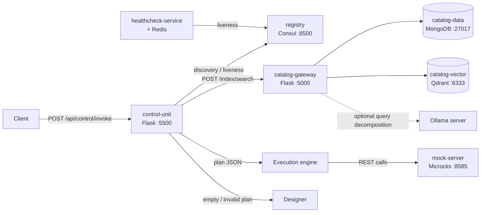

# MOSAIC

**Microservice Orchestration through Semantic Retrieval, Aggregation, and Interservice Chaining.**

MOSAIC turns a natural-language request into an executable plan over conventional REST
services. It retrieves the relevant operations from a live service catalog, generates a
JSON plan whose operations and parameters are grounded in the retrieved OpenAPI
specifications, executes the plan with an LLM-independent engine (resolving references
between tasks and aggregating results), and, when no plan can be built, diagnoses the
failure and — for out-of-domain requests — proposes the contract of the missing service.

The framework accompanies the manuscript *"Natural Language-Driven API Composition with
Enhanced Retrieval-Augmented Generation and Reasoning"* (Mazzitelli and Zimeo, IEEE
Transactions on Services Computing). The repository contains the implementation, the
mock service ecosystem, and the harnesses used for the RestBench, SOCBench-D,
distractor-injection, smart-city, and Designer evaluations.

---

## What it does

| Capability | Implementation |
|---|---|
| Two-stage retrieval with rank fusion | Bi-encoder over service descriptions, cross-encoder over endpoints, Reciprocal Rank Fusion (RRF), token-budgeted context |
| Composition without semantic annotation | Services are interpreted from their natural-language description plus their OpenAPI structure; no ontology or adapter is required |
| Schema-grounded plan generation | Decoding constrained to a grammar/schema instantiated from the retrieved operations: unknown endpoints and parameters cannot be generated |
| Plan validation and auto-repair | Structural and semantic checks, with one automatic correction pass for non-semantic errors |
| Cross-service data flow | References to earlier task results resolved at execution time, plus relational (SQL) aggregation for cross-service joins, filters, projections and ordering |
| Failure diagnosis | A dedicated **Designer** classifies unsatisfiable requests and synthesizes a candidate service contract for out-of-domain ones |
| Runtime discovery | Consul registry plus periodic health checks; only live services enter retrieval |

The planning step is **one-shot**: a single inference pass produces a declarative plan,
which a separate, LLM-independent engine executes. The planner model is not involved in
task dispatch.

---

## Architecture



### Pipeline stages

1. **Discovery.** The control unit queries Consul and keeps only the services whose
   health check is passing; the resulting live catalog is the search space.
2. **Retrieval.** The catalog gateway embeds a concept-extracted query and the service
   descriptions, keeps the top-$K_1$ services (default 7), reranks the endpoints of
   those services with a cross-encoder, and fuses the two rankings with RRF. The
   highest-scoring operations are packed into a token budget (default 7000). LLM-based
   query decomposition is optional.
3. **Planning.** The planner receives the retrieved operations and generates a JSON plan
   under a schema built from their identifiers and parameter names. The plan is then
   validated (operations in the retrieved set, required parameters present, references
   pointing to earlier tasks, aggregation fields existing) and repaired once if needed.
4. **Execution.** An LLM-independent engine walks the tasks in dependency order,
   substitutes references with values from earlier responses, invokes each endpoint, and
   evaluates the final relational aggregation as SQL.
5. **Diagnosis (Designer).** If the plan is empty or still invalid after repair, the
   Designer classifies the request as out-of-domain, ambiguous, invalid, or
   unclassifiable. Only for out-of-domain requests it proposes a contract for the
   missing service.

---

## Repository layout

```
.
├── Compose.yaml                 # full stack (catalog, registry, mocks, control unit)
├── control-unit/                # orchestration API: discovery, planning, execution, Designer
│   ├── app.py                   # Flask app, port 5500, Swagger at /swagger
│   ├── controller/              # POST /api/control/invoke
│   ├── service/
│   │   ├── orchestrator.py      # pipeline routing and telemetry
│   │   ├── discoveryService.py  # Consul discovery
│   │   ├── designerService.py   # failure classification + contract synthesis
│   │   ├── planning/            # prompt, LLM client, grammar/schema, validator
│   │   └── execution/           # executor, placeholder (reference) resolver
│   └── config/                  # planner prompts and plan output schema
├── db-gateway/                  # catalog gateway: indexing + two-stage retrieval
│   └── db-gateway.py            # Flask app, port 5000
├── api-importer/                # OpenAPI enrichment pipeline
├── redis-connector-quarkus/     # healthcheck-service (Quarkus)
├── MOCKS-smart-city/            # 11 smart-city OpenAPI specs + Groovy dispatchers
├── Eval/
│   ├── benchmark/               # RestBench (Spotify, TMDB) runner and plots
│   ├── datasets/                # RestBench queries with gold paths
│   ├── socbench/                # SOCBench-D retrieval harness and table builder
│   ├── designer_eval/           # 45 diagnostic queries + 100 in-domain queries
│   ├── service-mocks/           # Spotify/TMDB specs (legacy single-service setup)
│   └── results/                 # RestBench and ablation outputs
├── test_validation/             # smart-city end-to-end runner and robustness tests
├── deploy.sh / register.sh      # Microcks import and Consul registration
├── submitter.py                 # example client (legacy hard-coded path)
└── plan_validator.py            # standalone plan-check helper
```

---

## Getting started

### Prerequisites

- Docker and Docker Compose v2
- An Ollama server reachable from the containers, with the planner model pulled
  (default `qwen3.5:27b`)
- Python 3.10+ for the evaluation scripts (the stack itself runs in Docker)
- Disk space for the Hugging Face models (`Qwen/Qwen3-Embedding-0.6B`,
  `BAAI/bge-reranker-base`), cached in the `huggingface-cache` volume
- Enough RAM to load both models in the catalog gateway; a GPU is recommended for the
  Ollama server

### 1. Point the stack at your Ollama server

`Compose.yaml` ships with an external endpoint. Replace it with your own in both
services:

```yaml
# catalog-gateway
- OLLAMA_URL=http://<ollama-host>:11434
# control-unit
- OLLAMA_API_URL=http://<ollama-host>:11434
```

Then pull the model on that server:

```bash
ollama pull qwen3.5:27b
```

### 2. Start the stack

```bash
docker compose -f Compose.yaml up -d --build
```

On first start the `yaml-preprocessor` normalizes the OpenAPI files, the
`mock-deployer` imports the 11 smart-city services into Microcks, registers them in
Consul, and triggers schema enrichment; it is a one-shot job and exits with code 0.

### 3. Verify

```bash
curl -s http://localhost:5000/health          # catalog gateway
curl -s http://localhost:8500/v1/status/leader # Consul
curl -s http://localhost:8585/api/services     # Microcks
curl -s http://localhost:5000/services         # catalog contents
```

### 4. Send a request

```bash
curl -s http://localhost:5500/api/control/invoke \
  -H 'Content-Type: application/json' \
  -d '{
        "input": "Find available parking spots near the museum in the city center",
        "dry_run": true
      }'
```

- `dry_run: true` runs discovery, retrieval, planning and validation without calling
  the mock APIs; it is the mode used by the Designer harness.
- `max_rank` (optional) scopes the catalog to simulate $N$ injected distractors.
- Interactive API documentation is available at <http://localhost:5500/swagger>.

### 5. Stop or reset

```bash
docker compose -f Compose.yaml down      # keep catalog data
docker compose -f Compose.yaml down -v   # wipe MongoDB, Qdrant and Redis volumes
```

---

## Configuration

### Control unit

| Variable | Default | Purpose |
|---|---|---|
| `LLM_MODEL` | `qwen3.5:27b` | Planner model |
| `BACKEND_MODE` | `MOCK` | `MOCK` executes against Microcks, `REAL` against live services |
| `OLLAMA_API_URL` | `http://localhost:11434` | Ollama endpoint |
| `PLANNER_SYSTEM_PROMPT_PATH` | `config/prompts/planner_system.md` | System prompt |
| `PLANNER_OUTPUT_SCHEMA_PATH` | built-in schema | Optional JSON-schema override |
| `DESIGNER_LLM_MODEL` | `glm-4.7-flash:q4_K_M` | Designer model |
| `DESIGNER_TEMPERATURE` | `0.2` (`0` in Compose) | Designer sampling temperature |
| `DESIGNER_SEED` | unset (`42` in Compose) | Designer sampling seed |
| `DESIGNER_NUM_CTX` | `16384` | Designer context window |
| `REGISTRY_URL` | `http://registry:8500` | Consul endpoint |
| `CATALOG_URL` | `http://catalog-gateway:5000` | Catalog gateway endpoint |
| `MOCK_SERVER_URL` | `http://mock-server:8080` | Microcks endpoint used in `MOCK` mode |
| `API_AUTH_HEADERS` | empty | JSON headers injected into outgoing calls in `REAL` mode |

> The repository directory is `control-unit/config/shemas` (sic), while Compose points
> `PLANNER_OUTPUT_SCHEMA_PATH` to `/app/config/schemas/plan_output.json`. The path does
> not resolve, so the built-in `_default_output_schema()` is used. Set
> `PLANNER_OUTPUT_SCHEMA_PATH` explicitly if you want to override it.

### Catalog gateway

| Variable | Default | Purpose |
|---|---|---|
| `MONGO_*` | see `Compose.yaml` | Metadata store (services, endpoints, schemas) |
| `QDRANT_HOST` / `QDRANT_PORT` | `catalog-vector` / `6333` | Vector store |
| `QDRANT_COLLECTION` | `services` | Endpoint collection |
| `QDRANT_COLLECTION_INDEX` | `services_index` | Service-description collection |
| `OLLAMA_URL` | `http://ollama:11434` | Used only for optional LLM query decomposition |
| `USE_LLM_DECOMPOSITION` | `true` in Compose | Enable LLM query decomposition; set to `false` for the retrieval-only SOCBench-D protocol |
| `RETRIEVAL_TOKEN_BUDGET` | `7000` | Token budget for the retrieved operations |
| `RERANK_THREADS` | `8` | Cross-encoder parallelism (`0` lets ONNX Runtime decide) |
| `RERANK_BATCH_SIZE` | `16` | Cross-encoder batch size |

> `TOP_ENDPOINTS_PER_SERVICE` is passed by Compose but the effective cap is currently
> hard-coded to `6` in `db-gateway/db-gateway.py`, chosen to cover the largest smart-city
> service; the token budget remains the final guard.

---

## HTTP API

### Control unit

| Method | Path | Description |
|---|---|---|
| `POST` | `/api/control/invoke` | Run the pipeline on `{"input": "...", "dry_run": false, "max_rank": null}` |
| `GET` | `/swagger` | OpenAPI documentation |

### Catalog gateway

| Method | Path | Description |
|---|---|---|
| `GET` | `/health` | Liveness |
| `POST` | `/index/search` | Two-stage retrieval; body `{"query": "...", "max_rank": null}` |
| `POST` | `/service` | Add or update a service in the catalog |
| `GET` | `/services` | List indexed services |
| `GET` | `/services/<id>` | Service details |
| `DELETE` | `/services/<id>` | Remove a service |
| `PATCH` | `/services/<id>/rank` | Set the distractor rank used by `max_rank` |
| `PATCH` | `/services/<id>/schemas` | Update request/response schemas |
| `POST` | `/index/reindex` | Rebuild service-description embeddings |

---

## Service onboarding

1. Add an OpenAPI file to `MOCKS-smart-city/apis/` and, if the service needs dynamic
   behavior, a Groovy dispatcher with the **same base name** in
   `MOCKS-smart-city/scripts/` (for example `smart-lighting.yaml` and
   `smart-lighting.groovy`). File names are case-sensitive.
2. `yaml-preprocessor` normalizes the specifications (`scripts/fix_yaml.py`).
3. `mock-deployer` imports them into Microcks (`deploy.sh`), patches the dispatchers,
   and registers the services in Consul (`register.sh`).
4. `api-importer` enriches the catalog with request/response schemas
   (`POST /api/importer/enrich`).
5. `healthcheck-service` monitors the registered instances and updates their liveness in
   Consul; unhealthy services are excluded from retrieval.

To rebuild the catalog from scratch, reset the volumes and restart the stack.

---

## Evaluation

### RestBench (Spotify and TMDB)

```bash
python3 Eval/benchmark/test_runner.py \
  --datasets spotify tmdb \
  --control-url http://localhost:5500
```

Queries and gold paths are in `Eval/datasets/`; results are written to
`Eval/results/test_runs/<dataset>_<model>_<timestamp>/` (`responses.json`,
`metrics.json`, `per_query.csv`, `summary.txt`). Plans are scored against the gold paths
without calling the live APIs; the run is one-shot.

Reported in the manuscript (temperature 0, seed 42):

| Scenario | Success % | Correct Path % | Δ Solution Length |
|---|---:|---:|---:|
| Spotify | 80.7 | 64.9 (≈84.2 after manual reclassification) | +0.46 |
| TMDB | 79.0 | 87.0 (≈94.0 after manual reclassification) | +0.35 |

### SOCBench-D

```bash
cd Eval/socbench
./run.sh                     # full run: stack, registration, retrieval, table
./run.sh --skip-stack --skip-register   # reuse a running stack and existing index
```

SOCBench-D contains 5 instances × 11 GICS domains × 5 services × 10 endpoints and 550
queries with a mean gold set of 4.53 endpoints. The protocol is in-domain: the candidate
set is restricted to the five services of the query's domain, and LLM decomposition and
rewriting are disabled. See `Eval/socbench/README.md` for details and for the
`bge-small-en-v1.5` + `bge-reranker-base` retrieval-only variant used in the paper.

| R/P (%) | k=5 | k=10 | k=20 |
|---|---:|---:|---:|
| MOSAIC | 56.9 / 45.9 | 77.1 / 32.4 | 92.4 / 20.4 |
| Best baseline (NV-Embed-v2) | 54.6 / 44.0 | 69.9 / 29.7 | 89.2 / 20.0 |

Baseline figures are those published by Pesl et al.; they were not recomputed. The
comparison is at system level: MOSAIC adds a cross-encoder and rank fusion to a dense
retriever.

### Distractor robustness

```bash
python3 test_validation/robustness_test.py
```

Distractor services from the public apis.guru corpus are injected into the index at
levels 50, 100 and 150, and the same 100 smart-city queries are re-evaluated at each
level. Configure the run through the environment variables documented at the top of the
script; with a clean catalog use `SCOPE_MODE=import`, otherwise tag the distractors and
use `SCOPE_MODE=filter` (see the reindex/backfill/register_existing prerequisites in the
script docstring).

| Metric | 50 | 100 | 150 |
|---|---:|---:|---:|
| Endpoint coverage | 0.833 | 0.727 | 0.730 |
| Intrusion rate | 0.135 | 0.202 | 0.240 |
| Recall@5 | 0.927 | 0.859 | 0.840 |

### Smart-city end-to-end

```bash
python3 test_validation/testRunner.py \
  --control-url http://localhost:5500 \
  --csv test_validation/smart_city_test_requests.csv
```

A query is `CORRECT` only if it passes all four layers: gold path contained in the plan
(L1), no HTTP errors in mock execution (L2), correct resolution of placeholders (L3), and
payload compliance with write schemas (L4). Reported in the manuscript: 80/100 correct,
16 partial, 3 incorrect, 1 network timeout; 90% effective after manual reclassification
of benign variations and two runtime bugs.

### Designer

The Designer harness is documented in `Eval/designer_eval/README.md`. It uses 45
diagnostic queries (15 out-of-domain, 15 ambiguous, 15 invalid) and the 100 in-domain
smart-city queries, with two blind annotation sheets and an adjudication step.

```bash
# 1. annotate and adjudicate, then merge the labels
python3 -m Eval.designer_eval.apply_adjudication

# 2. run the official protocol (dry-run: planning + validation, no execution)
python3 -m Eval.designer_eval.run_designer_eval \
  --control-url http://localhost:5500 \
  --catalog Eval/designer_eval/catalog_snapshot.json \
  --out-dir Eval/designer_eval/results

# 3. compute metrics, confusion matrix and contract statistics
python3 -m Eval.designer_eval.analyze_designer_eval \
  --run-dir Eval/designer_eval/results/<run_id> \
  --scores-a <blind-scores-A.csv> \
  --scores-b <blind-scores-B.csv>
```

Designer metrics (manuscript, adjudicated labels):

| Metric | Value |
|---|---:|
| Diagnostic reach rate | 88.9% (40/45) |
| Classification accuracy (reached) | 95.0% (38/40) |
| Silent wrong plan rate | 11.1% (5/45); 0.0% on OOD |
| Contract yield (OOD) | 100% (15/15), all hard-valid |
| Smart-city false positives | 2.0% (2/100) |
| Abstention precision / recall / F1 | 95.2% / 88.9% / 92.0% |

Labels in `queries/designer_queries.csv` are proposals until the adjudication file is
filled; the analyzer merges the adjudicated categories from `annotations/adjudicated.csv`
without re-running the protocol.

---

## Reproducibility notes

- Deterministic runs use temperature `0` and seed `42` for both planner and Designer.
- The metrics above depend on the exact models: `qwen3.5:27b` for planning,
  `Qwen/Qwen3-Embedding-0.6B` for service retrieval, `BAAI/bge-reranker-base` for
  reranking. Substituting any of them changes the numbers.
- RestBench plans are scored against the gold paths without live API calls; the
  smart-city benchmark runs against Microcks mocks with a 90 s timeout.
- Each Designer run stores a manifest with the catalog snapshot hash. The snapshot is
  produced by `python3 -m Eval.designer_eval.fetch_catalog_snapshot`.
- `.gitignore` excludes `Eval/designer_eval/results/` and
  `Eval/designer_eval/catalog_snapshot.json`. Publish a specific run with `git add -f`,
  or relax the ignore rules, if you need it archived with the code.

---

## Troubleshooting

| Symptom | Cause / fix |
|---|---|
| `ModuleNotFoundError: No module named 'Eval'` | Run scripts from the repository root as modules: `python3 -m Eval.designer_eval.<script>`, or set `PYTHONPATH=.` |
| Catalog still contains services you removed | Stale MongoDB/Qdrant volumes: `docker compose -f Compose.yaml down -v` and restart |
| A service is missing after import | The OpenAPI basename and the Groovy dispatcher basename must match exactly, including case |
| `Connection refused` to Ollama | `OLLAMA_URL` / `OLLAMA_API_URL` still point to the example host; set your own |
| `mock-deployer` reported as exited | Expected: it is a one-shot import/registration job; check its logs if it exited non-zero |
| Retrieval quality differs from the paper | Confirm `USE_LLM_DECOMPOSITION`, the embedding/reranker models, and the token budget |

---

## Citation

```bibtex
@article{mazzitelli2026mosaic,
  title   = {Natural Language-Driven API Composition with Enhanced
             Retrieval-Augmented Generation and Reasoning},
  author  = {Mazzitelli, Francesco Cosimo and Zimeo, Eugenio},
  journal = {IEEE Transactions on Services Computing},
  year    = {2026},
  note    = {Manuscript}
}
```

## Acknowledgments

The authors thank Rita Lamparelli, who helped in developing the Designer component.
Generative AI tools were used for writing checks; the authors validated all outputs and
assume full responsibility for the content.

## License

The repository does not currently include a license file. Please contact the authors
before reusing the code.
